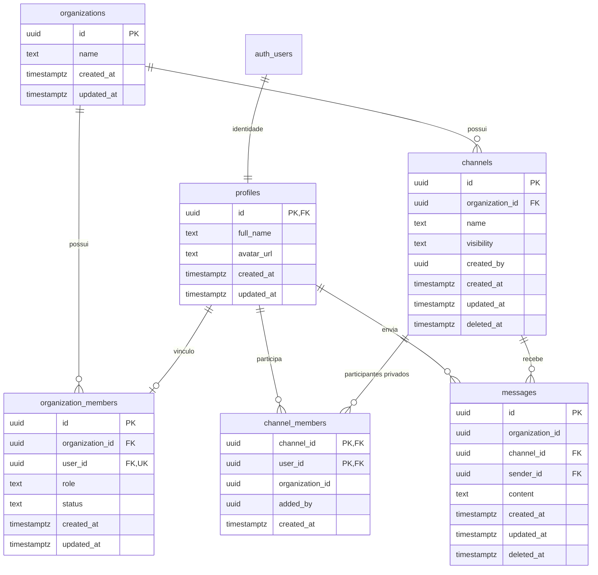

# Arquitetura inicial e modelo de dados — Connexa

> **Status deste documento:** referência técnica preliminar e legado, não normativa para decisões atuais de produto, autorização ou modelo de conversas. As decisões aprovadas para autorização e conversas da Issue #96 estão em [authorization-permissions-issue-96.md](./authorization-permissions-issue-96.md). Em caso de divergência, prevalecem os requisitos atuais aprovados e o documento específico da Issue #96; não reutilizar automaticamente entidades, papéis, cardinalidades ou políticas RLS deste modelo legado.

## 1. Objetivo

Registrar uma proposta técnica inicial de arquitetura e modelo de dados. O documento foi elaborado para um recorte anterior de canais e isolamento multiempresa e precisa ser reconciliado com os requisitos atuais de comunicação corporativa interna, incluindo colaboradores, departamentos, grupos, conversas individuais, mensagens, arquivos, comunicados, dispositivos, auditoria e chamadas em tempo real.

A aplicação terá experiência web mobile-first. A infraestrutura oficial será exclusivamente online, utilizando GitHub, Supabase e Vercel.

## 2. Arquitetura proposta (sujeita à revisão)

- **Vercel Online:** hospedagem e deploy da aplicação web.
- **Supabase Auth:** autenticação e identidade dos usuários.
- **Supabase PostgreSQL:** persistência dos dados relacionais.
- **Supabase Row Level Security (RLS):** autorização e isolamento dos registros.
- **Supabase Realtime:** atualização de eventos e mensagens, sujeita às mesmas regras de autorização.
- **GitHub Online:** versionamento do código, documentação e revisão das mudanças.

A arquitetura final deverá respeitar a diretriz de serviços online. A aplicação cliente não poderá expor credenciais privilegiadas. A chave `service_role` ou qualquer chave secreta nunca poderá ser disponibilizada no navegador.

**Atenção:** chamadas de áudio e vídeo em tempo real fazem parte do MVP aprovado pela PO. Não se deve interpretar o serviço Supabase Realtime, por si só, como transporte de mídia de áudio/vídeo. A solução de mídia, sinalização, SFU/TURN ou serviço gerenciado precisa de avaliação técnica específica e compatibilidade com a estratégia Vercel Online + Supabase Online.

## 3. Decisões e premissas deste modelo que precisam de reconciliação

O modelo abaixo ainda contém conceitos de uma versão anterior, como organizações multiempresa, papéis `owner/admin/member` e canais públicos/privados. A direção atual do produto descreve uma plataforma interna de uma organização, com três administradores principais de TI, equipe operacional de TI, colaboradores, departamentos, grupos e gestores departamentais.

Antes de usar o modelo físico ou as políticas RLS em implementação, revisar:
1. Entidades de colaborador, departamento, grupo, conversa individual e em grupo.
2. Papéis e permissões da TI (administradores principais e operacionais), sem reaproveitar automaticamente os papéis antigos.
3. Participação em grupos e regra de histórico após remoção.
4. Mensagens, anexos, edição, exclusão, recibos de leitura e retenção.
5. Comunicados, solicitações departamentais, dispositivos e auditoria.
6. Chamadas e seus metadados, participantes, convites, moderação e autorização.
7. Escopo de acesso administrativo a conversas e trilhas de auditoria.

## 4. Modelo legado de organizações, canais e mensagens

As seções seguintes preservam o modelo técnico anterior como referência de trabalho, não como decisão funcional atual. Cada entidade, cardinalidade, papel, regra de acesso e restrição precisa ser revalidada antes de implementação.

As seis tabelas próprias originalmente propostas são `organizations`, `profiles`, `organization_members`, `channels`, `channel_members` e `messages`. O Supabase também mantém `auth.users`, tabela gerenciada pelo Supabase Auth.

## 5. Regras técnicas legadas a revisar

O modelo original previa:
- Um usuário associado a no máximo uma organização.
- Um proprietário ativo por organização e papéis `owner`, `admin` e `member`.
- Canais públicos e privados.
- Participação explícita em canais privados.
- Isolamento de dados por organização usando chaves estrangeiras e RLS.
- Mensagens associadas a canais e autores.

Essas premissas não devem ser aplicadas automaticamente ao CONNEXA3 atual. O modelo de autorização precisa ser redesenhado em torno dos colaboradores, departamentos, grupos, conversas e níveis de administração de TI aprovados pela PO.

## 6. Segurança e RLS

RLS deverá ser habilitado nas tabelas expostas pelo schema público. As políticas devem derivar identidade de `auth.uid()`, validar associação ativa e autorização na conversa/recurso e impedir que o cliente atribua privilégios por meio de metadados editáveis.

As políticas definitivas ainda precisam ser projetadas e testadas com os papéis atuais do CONNEXA3. Não considerar a matriz antiga de owner/admin/member como matriz vigente.

## 7. Chamadas de áudio e vídeo — escopo aprovado

Chamadas individuais e em grupo de áudio e vídeo fazem parte do MVP. O requisito funcional, as regras de negócio, os critérios de aceitação, os diagramas e as pendências de arquitetura estão documentados em:

- [Requisitos do módulo de chamadas](../requirements/calls-audio-video.md)

O limite de até 50 participantes por chamada em grupo foi aprovado como requisito de produto e depende de validação de capacidade, desempenho, infraestrutura e custos. O desenho técnico da mídia deve ser elaborado em etapa própria.

## 8. Próximas atividades de arquitetura

1. Elaborar o modelo de domínio atualizado para colaboradores, departamentos, grupos, conversas, mensagens, arquivos, comunicados, dispositivos, auditoria e chamadas.
2. Atualizar a matriz de autorização com os três administradores principais e equipe operacional de TI.
3. Projetar RLS e testes negativos de acesso indevido.
4. Definir armazenamento e ciclo de vida de arquivos, mensagens e histórico.
5. Definir arquitetura de chamadas e validar capacidade para 50 participantes por grupo.
6. Revisar os documentos existentes de UX que ainda descrevem protótipo de atendimento ao cliente.

## 9. Referências

- [Supabase Row Level Security](https://supabase.com/docs/guides/database/postgres/row-level-security)
- [Supabase Auth](https://supabase.com/docs/guides/auth)
- [Supabase Realtime](https://supabase.com/docs/guides/realtime)

---

**Observação:** este documento é uma proposta de arquitetura em revisão. Ele não representa a execução de migrations, criação de tabelas, configuração de políticas no Supabase ou implementação de chamadas.
