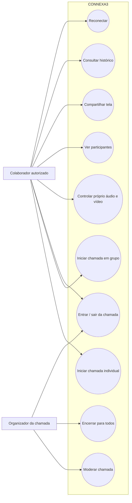
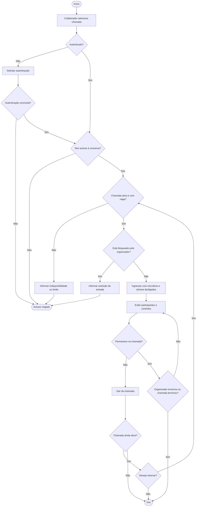
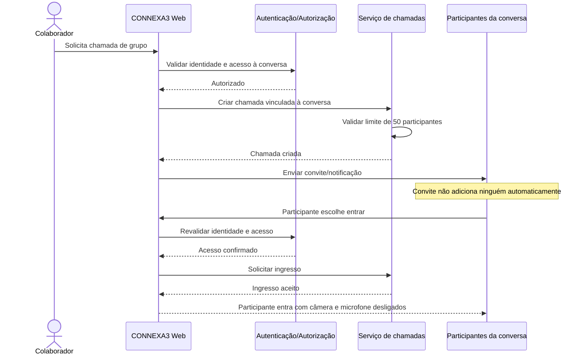

# Requisitos do módulo de chamadas — CONNEXA3

- **Status:** aprovado pela Product Owner; detalhamento técnico pendente
- **Escopo:** MVP
- **Produto:** plataforma web corporativa de comunicação interna
- **Público inicial estimado:** aproximadamente 900 colaboradores
- **Fonte de verdade:** decisões aprovadas pela PO durante a elicitação de requisitos

## 1. Objetivo

Permitir que colaboradores realizem chamadas de áudio e vídeo em tempo real, individuais ou em grupo, integradas às conversas do CONNEXA3. O módulo deve favorecer comunicação espontânea, colaboração e reuniões internas, mantendo controle de acesso, privacidade e moderação.

## 2. Escopo aprovado

O MVP contempla:
- Chamadas individuais de áudio e de vídeo.
- Chamadas em grupo de áudio e de vídeo.
- Até **50 participantes simultâneos** em uma chamada em grupo.
- Iniciação por qualquer colaborador que tenha acesso à conversa correspondente.
- Convites/notificações para os participantes da conversa; entrada voluntária.
- Microfone e câmera desligados por padrão ao entrar.
- Entrada e saída voluntárias durante a chamada, respeitadas as restrições de moderação.
- Controles individuais de microfone e câmera.
- Lista de participantes.
- Controles de organização/moderação.
- Histórico de chamadas, sem gravação.
- Criptografia durante a transmissão e validação de identidade/acesso.
- Compartilhamento de tela, com uma pessoa compartilhando por vez.
- Adaptação automática de qualidade e tentativa automática de reconexão.
- Duração sem limite máximo predefinido.

## 3. Requisitos funcionais

### RF-CALL-001 — Iniciar chamada individual
O sistema deve permitir que qualquer colaborador autenticado e autorizado inicie uma chamada de áudio ou vídeo a partir de uma conversa individual à qual tenha acesso.

**Critérios de aceitação**
- Dado que o colaborador esteja autenticado e tenha acesso à conversa individual, quando selecionar chamada de áudio ou vídeo, então o sistema deve iniciar o fluxo de chamada.
- Se não tiver acesso à conversa ou a conta estiver sem autorização, a chamada não deve ser iniciada.
- A ação não deve depender de autorização prévia da equipe de TI.

### RF-CALL-002 — Iniciar chamada em grupo
O sistema deve permitir que qualquer participante autorizado inicie uma chamada de áudio ou vídeo a partir de uma conversa em grupo à qual tenha acesso.

**Critérios de aceitação**
- Somente colaboradores com acesso vigente à conversa podem iniciar ou participar.
- A chamada deve aceitar no máximo 50 participantes simultâneos.
- A tentativa de entrada acima do limite deve ser recusada com mensagem clara, sem interromper os participantes já conectados.

### RF-CALL-003 — Convidar participantes
Ao iniciar uma chamada em grupo, o sistema deve notificar/convidar os participantes elegíveis da conversa.

**Critérios de aceitação**
- O convite não deve inserir automaticamente ninguém na chamada.
- Cada pessoa decide se deseja entrar.
- A entrada não deve ativar automaticamente microfone ou câmera.
- A interface deve deixar claro quando a chamada está em andamento e oferecer a ação de entrar.

### RF-CALL-004 — Entrar, sair e retornar
O participante autorizado pode entrar durante uma chamada ativa, sair voluntariamente e retornar enquanto a chamada permanecer ativa, desde que não esteja bloqueado por moderação.

**Critérios de aceitação**
- A entrada e saída voluntárias não exigem autorização individual do organizador.
- O participante que sair voluntariamente pode retornar enquanto a chamada estiver ativa e houver vaga.
- A restrição temporária de novas entradas aplicada pelo organizador deve ser respeitada.
- Uma pessoa removida pelo organizador não pode retornar à mesma chamada enquanto ela permanecer ativa.
- A remoção da chamada não revoga o acesso da pessoa à conversa original.
- Ao encerrar a chamada, a restrição de retorno associada àquela chamada deixa de existir.

### RF-CALL-005 — Controles do participante
Todos os participantes podem:
- Ativar e desativar o próprio microfone.
- Ligar e desligar a própria câmera.
- Alternar entre áudio e vídeo quando o dispositivo e a chamada oferecerem suporte.
- Visualizar a lista de participantes.

**Critérios de aceitação**
- Microfone e câmera iniciam desligados quando o participante entra.
- Cada controle apresenta seu estado atual de forma perceptível.
- Falta de permissão de câmera/microfone no navegador deve ser comunicada sem impedir indevidamente a participação somente por áudio, quando possível.

### RF-CALL-006 — Controles do organizador
O organizador da chamada possui controles adicionais para:
- Encerrar a chamada para todos.
- Remover um participante.
- Silenciar o microfone de outro participante.
- Bloquear temporariamente novas entradas.

**Critérios de aceitação**
- Somente o organizador pode executar os controles de moderação definidos neste requisito.
- O sistema deve identificar claramente a ação de moderação e seu resultado.
- Ao remover alguém, deve aplicar o bloqueio de retorno até o encerramento daquela chamada.
- Silenciar outra pessoa não deve ligar sua câmera nem alterar configurações do dispositivo.
- O bloqueio de novas entradas não deve desconectar participantes que já estejam na chamada.
- O organizador pode liberar novas entradas novamente, se o bloqueio for temporário.

### RF-CALL-007 — Histórico de chamadas
O sistema deve disponibilizar histórico aos participantes autorizados, contendo:
- Quem iniciou a chamada.
- Data e horário.
- Duração.
- Participantes.
- Chamadas perdidas e não atendidas.

**Critérios de aceitação**
- O histórico deve ser acessível somente a pessoas autorizadas conforme as regras da conversa.
- O registro deve descrever metadados da chamada, não seu conteúdo de áudio/vídeo.
- Chamadas perdidas e não atendidas devem ser distinguíveis de chamadas efetivamente conectadas.
- A duração deve refletir o período efetivo da chamada, segundo regra técnica a ser definida.

### RF-CALL-008 — Compartilhamento de tela
O sistema deve permitir compartilhamento de tela durante chamadas individuais e em grupo no MVP.

**Critérios de aceitação**
- Qualquer participante da chamada pode iniciar o compartilhamento da própria tela.
- Somente um compartilhamento pode estar ativo por vez.
- O participante que iniciou pode encerrar seu compartilhamento.
- O organizador pode interromper o compartilhamento ativo.
- Compartilhar a tela não concede controle remoto do dispositivo.
- O sistema deve solicitar e respeitar as permissões do navegador/sistema operacional.

### RF-CALL-009 — Adaptação de qualidade
O sistema deve ajustar automaticamente a qualidade de áudio e vídeo de acordo com as condições de rede de cada participante, priorizando a continuidade da chamada.

**Critérios de aceitação**
- Em condições de rede degradadas, o sistema deve adaptar a qualidade, especialmente reduzindo a qualidade/resolução do vídeo quando necessário.
- O áudio deve receber prioridade para preservar a inteligibilidade.
- Quando a rede melhorar, a qualidade pode ser recuperada automaticamente.
- A implementação deve expor métricas suficientes para testes técnicos de qualidade.

### RF-CALL-010 — Reconexão
O sistema deve tentar recuperar automaticamente a conexão de um participante após perda temporária de rede.

**Critérios de aceitação**
- O participante deve receber aviso de instabilidade/perda de conexão.
- O sistema deve iniciar tentativa automática de reconexão.
- O participante pode retornar se a chamada ainda estiver ativa, houver vaga e não existir bloqueio de moderação.
- Se a chamada terminar durante a desconexão, a ocorrência deve ser refletida no histórico de acordo com a regra de registro definida.
- A reconexão não deve criar uma segunda participação duplicada para o mesmo usuário.

### RF-CALL-011 — Duração
As chamadas não terão duração máxima predefinida pelo produto.

**Critérios de aceitação**
- Chamadas individuais e em grupo podem permanecer ativas enquanto houver participantes e condições técnicas para mantê-las.
- Limites operacionais de infraestrutura, inatividade, quotas ou encerramento por falha deverão ser definidos na arquitetura e comunicados de forma clara.
- A ausência de limite de produto não significa capacidade técnica ilimitada.

## 4. Requisitos não funcionais e segurança

### RNF-CALL-001 — Criptografia em trânsito
Áudio, vídeo e dados de sinalização relacionados à chamada devem ser protegidos durante a transmissão por mecanismos criptográficos adequados ao protocolo e à arquitetura escolhidos.

### RNF-CALL-002 — Autenticação e autorização
Antes de permitir a entrada, o sistema deve autenticar o usuário e validar que ele possui acesso vigente à conversa associada.

### RNF-CALL-003 — Revogação de acesso
Alterações de autorização, suspensão de conta ou remoção da conversa devem ser consideradas pelo mecanismo de controle de acesso da chamada. A equipe técnica deve definir como propagar e aplicar a revogação durante sessões já ativas.

### RNF-CALL-004 — Privacidade por padrão
Microfone e câmera devem permanecer desligados no ingresso. O sistema não deve iniciar gravação automática.

### RNF-CALL-005 — Compatibilidade e permissões
O módulo deve funcionar em navegadores/dispositivos suportados pela aplicação web e tratar permissões de câmera, microfone e compartilhamento de tela de forma compreensível. A matriz de navegadores e dispositivos será definida na validação técnica.

### RNF-CALL-006 — Capacidade e desempenho
A capacidade para 50 participantes por chamada em grupo é requisito de produto aprovado, mas depende de prova técnica de desempenho, infraestrutura, largura de banda, custos e comportamento em dispositivos móveis. A meta de capacidade deve ser validada em teste representativo antes da liberação.

### RNF-CALL-007 — Resiliência
A experiência deve priorizar continuidade e recuperação de chamadas diante de oscilações de rede, sem prometer disponibilidade quando a conectividade ou os serviços essenciais estiverem indisponíveis.

## 5. Regras de negócio

- **RB-CALL-001:** chamadas individuais e em grupo oferecem áudio e vídeo em tempo real.
- **RB-CALL-002:** o limite aprovado para chamadas em grupo é de 50 participantes simultâneos.
- **RB-CALL-003:** qualquer colaborador pode iniciar chamada se tiver acesso à conversa correspondente.
- **RB-CALL-004:** o convite não equivale a ingresso; cada pessoa entra voluntariamente.
- **RB-CALL-005:** microfone e câmera começam desligados ao entrar.
- **RB-CALL-006:** participantes podem entrar e sair livremente durante a chamada, salvo restrição temporária de entrada ou bloqueio individual de retorno.
- **RB-CALL-007:** o organizador pode remover participante, silenciar microfone de outra pessoa, bloquear temporariamente novas entradas e encerrar a chamada para todos.
- **RB-CALL-008:** pessoa removida não retorna à mesma chamada enquanto ela estiver ativa; o acesso à conversa não é revogado por essa remoção.
- **RB-CALL-009:** somente uma pessoa compartilha tela por vez; o organizador pode interromper o compartilhamento.
- **RB-CALL-010:** compartilhar tela não concede controle remoto do dispositivo.
- **RB-CALL-011:** o histórico contém metadados e está restrito aos participantes autorizados.
- **RB-CALL-012:** gravação nativa de áudio/vídeo está fora do MVP.
- **RB-CALL-013:** não há duração máxima predefinida pelo produto; limites técnicos operacionais ainda serão definidos.
- **RB-CALL-014:** reconexão e retorno só são possíveis enquanto a chamada estiver ativa, houver capacidade e não houver impedimento de moderação.
- **RB-CALL-015:** a autorização de chamada decorre do acesso vigente à conversa; pertencer à empresa, isoladamente, não basta quando o usuário não tem acesso à conversa.

## 6. Diagramas UML (Mermaid)

### 6.1 Diagrama de Casos de Uso

### 6.2 Diagrama de Atividades — ingresso em chamada de grupo

### 6.3 Diagrama de Sequência — iniciar chamada e convidar grupo

## 7. Fora do escopo do MVP

- Gravação nativa de chamadas de áudio ou vídeo.
- Controle remoto do dispositivo de outro participante.
- Duração máxima fixa definida pelo produto.

## 8. Pendências de validação técnica

1. Seleção da tecnologia/protocolo de mídia e sinalização compatível com Vercel Online e Supabase Online; não presumir que Supabase Realtime, isoladamente, transporte mídia de áudio/vídeo.
2. Arquitetura de mídia para chamadas de até 50 participantes, incluindo avaliação de SFU, TURN e serviços gerenciados quando necessários.
3. Testes de carga, concorrência de chamadas, consumo de rede, bateria e desempenho em dispositivos móveis.
4. Métricas e metas objetivas de latência, jitter, perda de pacotes, tempo de conexão e recuperação.
5. Política de expiração por inatividade e limites operacionais, sem contradizer a ausência de duração máxima de produto.
6. Comportamento detalhado quando organizador perde conexão ou sai voluntariamente: transferência de organização, continuidade ou encerramento.
7. Regras de notificação de chamada perdida e preferências de notificações.
8. Regras de retenção do histórico e auditoria, alinhadas à política geral de retenção e à LGPD.
9. Regras de moderação em chamadas individuais (a aprovação de controles adicionais foi definida para o organizador de chamadas em grupo; não extrapolar automaticamente).
10. Suporte por navegador e tratamento de permissões de câmera, microfone e compartilhamento de tela.
11. Como a revogação de acesso à conversa afetará uma chamada que já esteja em andamento.
12. Requisitos legais, de privacidade e transparência aplicáveis ao uso de áudio, vídeo e metadados de chamadas.

## 9. Rastreabilidade das decisões da PO

| Decisão | Registro |
|---|---|
| Chamadas individuais e em grupo, áudio e vídeo | Aprovada |
| Até 50 participantes em grupo | Aprovada, sujeita à prova técnica |
| Qualquer colaborador com acesso à conversa pode iniciar | Aprovada |
| Convite voluntário, sem ingresso automático | Aprovada |
| Câmera e microfone desligados ao entrar | Aprovada |
| Entrada e saída livres, respeitando moderação | Aprovada |
| Controles próprios e lista de participantes | Aprovada |
| Organizador pode moderar e encerrar para todos | Aprovada |
| Removido não retorna à mesma chamada ativa | Aprovada |
| Histórico de metadados para participantes autorizados | Aprovada |
| Sem gravação no MVP | Aprovada |
| Criptografia em trânsito e validação de acesso | Aprovada; implementação a validar |
| Compartilhamento de tela, um por vez | Aprovada |
| Adaptação automática da qualidade | Aprovada |
| Tentativa automática de reconexão | Aprovada |
| Sem duração máxima predefinida | Aprovada; limites operacionais pendentes |

## 10. Critérios de conclusão documental

- [x] Decisões aprovadas registradas sem ampliar seu significado.
- [x] Requisitos funcionais identificados.
- [x] Regras de negócio identificadas.
- [x] Critérios de aceitação documentados.
- [x] Requisitos não funcionais e de segurança documentados.
- [x] Três diagramas UML selecionados documentados.
- [x] Pendências técnicas separadas das decisões de produto.
- [ ] Revisão técnica de arquitetura e estimativa de custos.
- [ ] Validação de privacidade, retenção e requisitos legais.
- [ ] Testes de capacidade e compatibilidade antes da liberação.
